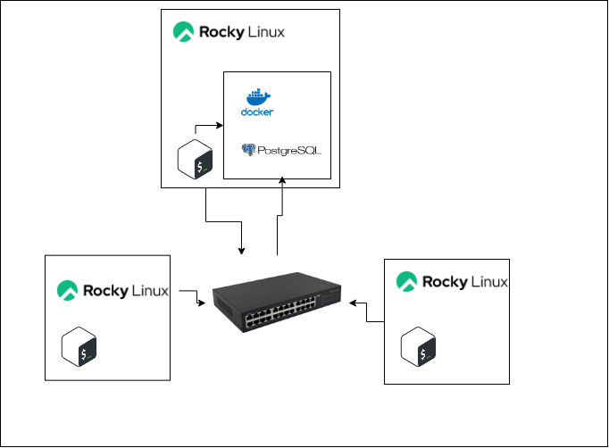

# Linux Cluster Monitoring Agent
This project was designed to create a cluster monitoring solution for the Jarvis Linux Cluster Administration (LCA) team. This solution records hardware specifications, monitors resource usage on a deployed server in real time, and stores the information in PostgreSQL, a Relational Database Management System (RDBMS). This information will then support resource planning, including decisions to add or remove servers. This project is implemented using Linux command lines , Bash scripts, Docker, and PostgreSQL. A Bash script monitors resource usage, runs every minute via crontab, and saves the information to a PostgreSQL instance deployed with Docker. The source code is managed with Git on GitHub.
# Quick Start

1. Start a psql instance using psql_docker.sh

```
#To provision a psql instance using docker, run the following command:
./scripts/psql_docker.sh create db_username db_password
#To start the psql docker container:
./scripts/psql_docker.sh start
#To connect to psql instance as user postgres, run the following command:
export PGPASSWORD=USER_PASSWORD
psql -h localhost -U postgres -d postgres -W
```

2. Create tables using ddl.sql

```
psql -h localhost -U postgres -d host_agent -f sql/ddl.sql
```

3. Insert hardware specs data into the host_info table in the database, "host_agent" using host_info.sh. Run only once

```
./scripts/host_info.sh psql_host psql_port db_name psql_user psql_password
#example where USER_PASSWORD=’password’:
./scripts/host_info.sh "localhost" 5432 "host_agent" "postgres" "password"
```

4. Insert hardware usage data into the host_usage table in the database using host_usage.sh. This can be scheduled to be run every minute; please look at bullet point 5.

```
bash scripts/host_usage.sh psql_host psql_port db_name psql_user psql_password
#example:
bash scripts/host_usage.sh localhost 5432 host_agent postgres password ​
```

5. Crontab setup to run host_usage.sh every minute to save the hardware usage data:

```
#To be able to edit crontab jobs, run the following command:
crontab -e
#Add the following command to crontab. Change the file path to the appropriate location.

* * * * * bash /home/rocky/dev/jarvis_data_eng_SheidaKhodabakhshian/linux_sql/scripts/host_usage.sh localhost 5432 host_agent postgres password > /tmp/host_usage.log
```

# Implementation

## Architecture

<div align="center">

</div>

## Scripts

### psql_docker.sh

#### Description:

A Bash script to create/start/stop PostgreSQL instance deployed using docker. It can be used to create a psql docker container given the username and password and start/stop it.

#### Script Usage

```
./scripts/psql_docker.sh start|stop|create [db_username][db_password]

# examples

## create a psql docker container with the given username and password.

## print error message if username or password is not given

## print error message if the container is already created

./scripts/psql_docker.sh create db_username db_password

## start the stopped psql docker container

## print error message if the container is not created

./scripts/psql_docker.sh start

## stop the running psql docker container

## print error message if the container is not created

./scripts/psql_docker.sh stop
```

### ddl.sql

#### Description

SQL file to create the tables host_info and host_usage in the existing database host_agent in the psql instance.

#### Script Usage

```
#Execute ddl.sql script on the host_agent database against the psql instance 
psql -h localhost -U postgres -d host_agent -f sql/ddl.sql
```

### host_info.sh

#### Description

A Bash script to collect hardware specification data like CPU model and architecture and save them to the host_info table in the host_agent database in the psql instance. This script will be executed once.

#### Script Usage

```
# Script usage
./scripts/host_info.sh psql_host psql_port db_name psql_user psql_password

# Example
./scripts/host_info.sh "localhost" 5432 "host_agent" "postgres" "password"
```

### host_usage.sh

#### Description

A Bash script to collect server usage data and save them to the host_usage table in the host_agent database in the psql instance.This script will be executed every minute using Linux's cron scheduler.

#### Script Usage

```
# Script usage
bash scripts/host_usage.sh psql_host psql_port db_name psql_user psql_password
# Example
bash scripts/host_usage.sh localhost 5432 host_agent postgres password
```

### crontab

#### Description

The crontab configuration file allows a user to schedule a job using the Cron scheduler. In this project, cron is used to schedule the execution of host_usage.sh every minute to collect usage data continuously.

#### Script Usage

```
# To edit crontab jobs
crontab -e
# Usage to schedule the execution of host_usage.sh every minute.
* * * * * bash /home/rocky/dev/jarvis_data_eng_SheidaKhodabakhshian/linux_sql/scripts/host_usage.sh localhost 5432 host_agent postgres password > /tmp/host_usage.log
```

### queries.sql
#### Description
SQL queries to address business problems. One query groups hosts by hardware info (CPU number), another displays the average used memory in percentage over 5 mins interval for the host. The third displays detected host failures. 
#### Script Usage
```
psql -h localhost -U postgres -d host_agent -f sql/queries.sql
```
## Database Modeling

### host_info table schema

| Column           | Type      | Constraints           | Description                                                 |
| :--------------- | :-------- | :-------------------- | :---------------------------------------------------------- |
| id               | SERIAL    | PRIMARY KEY, NOT NULL | Auto-gernerated incrementing unique identifier for the host |
| hostname         | VARCHAR   | UNIQUE, NOT NULL      | Unique hostname identifying the host machine                |
| cpu_number       | INT2      | NOT NULL              | Total CPU core count                                        |
| cpu_architecture | VARCHAR   | NOT NULL              | CPU architecture (e.g., x86_64,arm64)                       |
| cpu_model        | VARCHAR   | NOT NULL              | CPU model name                                              |
| cpu_mhz          | FLOAT8    | NOT NULL              | CPU clock speed (MHz)                                       |
| l2_cache         | INT4      | NOT NULL              | Size of the L2 cache (KB)                                   |
| timestamp        | TIMESTAMP | can be NULL           | host info collection timestamp in UTC                       |
| total_mem        | INT4      | can be NULL           | Total memory (KB)                                           |

### host_usage

| Column         | Type      | Constraints           | Description                                               |
| :------------- | :-------- | :-------------------- | :-------------------------------------------------------- |
| timestamp      | TIMESTAMP | NOT NULL              | Timestamp at which usage metrics was collected in UTC     |
| host_id        | SERIAL    | FOREIGN KEY, NOT NULL | Reference to host ID, the primary key of host_info table  |
| memory_free    | INT4      | NOT NULL              | Available free memory(MB)                                 |
| cpu_idle       | INT2      | NOT NULL              | Percentage of time the CPU spent idle                     |
| cpu_kernel     | INT2      | NOT NULL              | Percentage of time the CPU spent running kernel processes |
| disk_io        | INT4      | NOT NULL              | Number of active disk input and output operations         |
| disk_available | INT4      | NOT NULL              | Available disk space in root directory (MB)               |

# Test

The LCA team manages a Linux cluster of 10 servers running Rocky Linux connected through a switch, however, for this project, the solution is only tested on a single machine instead of a Linux cluster.
To test:

1. Log in as rocky user

```
su rocky
```

2. Execute the host_info.sh using the command:

```
./scripts/host_info.sh "localhost" 5432 "host_agent" "postgres" "password"
```

3. Connect to psql instance (assuming the psql container is already created and running; see section deployment) and connect to the database host_agent:

```
export PGPASSWORD='password'
psql -h localhost -U postgres -d postgres -W
postgres=# \c host_agent;
```

4. View host_info and host_usage tables to ensure the data was collected

```
host_agent=# SELECT * from host_info;
 id |                                        hostname                           
              | cpu_number | cpu_architecture |           cpu_model            |
 cpu_mhz | l2_cache |      timestamp      | total_mem 
----+---------------------------------------------------------------------------
--------------+------------+------------------+--------------------------------+
---------+----------+---------------------+-----------
  2 | jrvs-remote-desktop.northamerica-northeast2-c.c.project-45fc28f4-d7d6-4ae5
-b43.internal |          2 | x86_64           | Intel(R) Xeon(R) CPU @ 2.20GHz |
    2200 |      256 | 2026-11-19 21:30:23 |   7346580
(1 row)

host_agent=# SELECT * FROM host_usage;
      timestamp      | host_id | memory_free | cpu_idle | cpu_kernel | disk_io |
 disk_available
---------------------+---------+-------------+----------+------------+---------+
----------------
 2026-11-13 21:17:39 |       1 |        4945 |       96 |          2 |       0 |
          17757
 2026-11-13 21:45:01 |       1 |        4919 |       96 |          1 |       0 |
          17746
 2026-11-13 21:46:01 |       1 |        4934 |       96 |          1 |       0 |
          17746
 2026-11-13 21:47:01 |       1 |        4952 |       96 |          2 |       0 |
          17746
 2026-11-13 21:48:01 |       1 |        4947 |       96 |          2 |       0 |
          17746
 2026-11-13 21:49:02 |       1 |        4951 |       96 |          2 |       0 |
          17746
 2026-11-13 21:49:20 |       1 |        4951 |       96 |          2 |       0 |
          17746
 2026-11-13 21:50:01 |       1 |        4975 |       96 |          2 |       0 |
          17746
 2026-11-13 21:51:01 |       1 |        5086 |       96 |          2 |       0 |
          17746

```

# Deployment

The PostgreSQL instance is deployed using docker.

```
# To create a psql docker container, the following command is run:
./scripts/psql_docker.sh create db_username db_password
# To start the docker container, run the command:
./scripts/psql_docker.sh start
# To stop the docker container, run the command:
./scripts/psql_docker.sh stop
```
The host_info.sh is executed manually once while host_usage.sh is scheduled to run every minute using Cron.
```
# To edit crontab jobs
crontab -e
# Usage to schedule the execution of host_usage.sh every minute.
* * * * * bash /home/rocky/dev/jarvis_data_eng_SheidaKhodabakhshian/linux_sql/scripts/host_usage.sh localhost 5432 host_agent postgres password > /tmp/host_usage.log
```

# Improvements

- Add more parameters to measure in host_usage.sh like CPU load average and swap memory used.
- Create a single script to connect to the psql instance,execute host_info.sh, and set up a cron job to run host_usage.sh every minute on a new server.
- Test the solution using multiple servers running Rocky Linux connected through a switch, and ensure the PostgreSQL password is shared across nodes securely.

